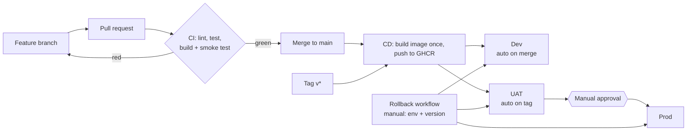

# release-pipeline-mini

A small, end-to-end release pipeline built to learn release management and deployment governance: a FastAPI service goes through CI, staged CD (Dev, UAT, Prod with manual approval), and a rollback workflow, with every deployment leaving a log line.

The application is intentionally tiny (`/health`, `/version`). The point of the project is the pipeline around it.

## Pipeline overview



| Stage | Trigger | Gate |
|---|---|---|
| CI | every PR and push to `main` | lint (ruff), tests (pytest), Docker build, smoke test |
| Dev | merge to `main` | smoke test: `/health` is ok and `/version` matches the image version |
| UAT | tag `v*` (for example `v0.2.1`) | same smoke test |
| Prod | after UAT succeeds | required reviewer approval (GitHub environment protection) plus the same smoke test |
| Rollback | manual (`workflow_dispatch`) | pick environment and version, smoke test confirms that version is running |

Design choices:
- **Build once, deploy many.** One image is built per commit or tag and pushed to GHCR. The same image moves through Dev, UAT and Prod, so what was tested is what ships.
- **`main` is protected by a ruleset.** Changes must go through a pull request, and the `lint-test` and `build` checks must pass before merge. Force pushes are blocked.
- **Smoke test checks the version, not just liveness.** After each deployment the pipeline calls `/health`, then reads `/version` and fails if it does not match the version that was supposed to be deployed.
- **Deployment log.** Every deploy and rollback writes one line (time, environment, version, result, duration) to the job summary.

## Deployment log (real output)

```
deploy   | 2026-10-30T03:46:27Z | dev  | sha-7c55acb | success | 7s
deploy   | 2026-10-30T04:03:04Z | uat  | v0.1.0      | success | 6s
deploy   | 2026-10-30T04:06:01Z | prod | v0.1.0      | success | 5s
rollback | 2026-10-30T09:16:58Z | uat  | v0.1.0      | success | 5s
deploy   | 2026-10-30T09:34:48Z | uat  | v0.2.1      | success | 8s
```

The gap between the UAT and Prod lines for `v0.1.0` (about three minutes) is the time the release waited for manual approval.

## Failure notes and fixes

| # | What failed | How it showed up | Cause | Fix |
|---|---|---|---|---|
| 1 | First CI run | `lint-test` red, pytest "import file mismatch" during collection (exit code 2) | The repo was pushed with a duplicated nested project folder, so two `test_main.py` files existed | Removed the duplicate folder through a commit; CI went green |
| 2 | Exercise: removed `os.getenv` from the app | Ruff `F401` ("imported but unused"), CI red, `build` skipped | `import os` became unused | Caught by lint before any test ran |
| 3 | Exercise: edited the line with extra quotes | Ruff `SyntaxError`, four errors from one mistake | Quotes wrapped around a function call | Removed the outer quotes |
| 4 | Exercise: typo in the env var name (`APP_VERSIO`) | CI green, but `deploy-dev` red after merge: running version `hardcoded`, expected `sha-44ef2f6` | The app read the wrong variable, so it never received the version set by the Dockerfile. Lint and tests could not see it | Smoke test caught it on Dev |
| 5 | Same bug tagged as `v0.2.0` | `deploy-uat` red, `deploy-prod` skipped | Same defect, now in the tagged image | The stage gate kept Prod on `v0.1.0` |
| 6 | Recovery | Rollback workflow restored `v0.1.0` on UAT; typo fixed through a pull request; new tag `v0.2.1` went through UAT and, after approval, Prod | n/a | Published a new version instead of reusing `v0.2.0` |

## What I learned

- A green CI is not proof that a release is correct. The typo passed lint and tests and was only caught by checking the running version after deployment.
- Stage gates limit the blast radius: the broken version stopped at UAT and never reached Prod.
- Rollback is fast because every version's image is kept in the registry; it does not rebuild from code.
- Published versions are not reused. A fix ships as a new version.
- A known gap: UAT does not depend on Dev, so a red Dev does not block a tag. In practice, tags should only be cut from a green `main`.

## Run locally

```
python -m venv .venv && source .venv/bin/activate   # Windows: .venv\Scripts\activate
pip install -r requirements-dev.txt
ruff check . && pytest -q
uvicorn app.main:app --reload
```

With Docker:

```
APP_VERSION=0.1.0 docker compose up --build
curl localhost:8000/health
curl localhost:8000/version
```

## Roadmap

- [x] FastAPI service, tests, Dockerfile
- [x] CI: lint, test, build, smoke test
- [x] Branch protection ruleset
- [x] CD to Dev, UAT, Prod with approval; rollback workflow
- [ ] Ansible playbook to install Docker and run the app on a local Linux machine
- [ ] Automatic changelog and deployment log exported to CSV
- [ ] Release analytics (success rate, lead time, failure patterns) from the log
