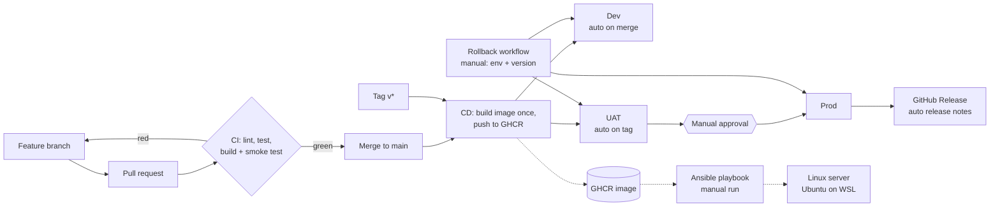

# release-pipeline-mini

A small, end-to-end release pipeline built to learn release management and deployment governance. A FastAPI service goes through CI, staged CD (Dev, UAT, Prod with manual approval), a rollback workflow, and an Ansible playbook that places a chosen version on a Linux server. Every deployment leaves a trace: a log line, a CSV export, and automatic release notes.

The application is intentionally tiny (`/health`, `/version`). The point of the project is the pipeline around it.

## Pipeline overview



Solid lines are automated by GitHub Actions. Dotted lines are the Ansible path, which is run by hand for now (see the limits below).

| Stage | Trigger | Gate |
|---|---|---|
| CI | every PR and push to `main` | lint (ruff), tests (pytest), Docker build, smoke test |
| Dev | merge to `main` | smoke test: `/health` is ok and `/version` matches the image version |
| UAT | tag `v*` (for example `v0.3.0`) | same smoke test |
| Prod | after UAT succeeds | required reviewer approval (GitHub environment protection) plus the same smoke test |
| Release notes | after Prod succeeds | GitHub Release created with generated notes (only that job has write permission) |
| Rollback | manual (`workflow_dispatch`) | pick environment and version, smoke test confirms that version is running |

Design choices:
- **Build once, deploy many.** One image per commit or tag is pushed to GHCR. The same image moves through Dev, UAT and Prod, so what was tested is what ships.
- **`main` is protected by a ruleset.** Changes go through a pull request, and the `lint-test` and `build` checks must pass before merge. Force pushes are blocked.
- **The smoke test checks the version, not just liveness.** After each deployment the pipeline calls `/health`, then reads `/version` and fails if it does not match the version that was supposed to be deployed.
- **Least privilege.** Workflows are read-only by default. Only the release-notes job can write, and only after Prod succeeded.

## Repository layout

```
app/                  FastAPI service
tests/                pytest tests
Dockerfile, docker-compose.yml
ansible/              inventory.ini, deploy.yml (Linux deployment playbook)
scripts/              export_deploy_log.py (deployment history to CSV)
data/                 deploy_log.csv (generated by the script)
.github/workflows/    ci.yml, cd.yml, rollback.yml
```

## Ansible deployment

`ansible/deploy.yml` installs Docker on a Linux host and runs a chosen image version from GHCR, then checks `/health` and asserts that `/version` matches. Tasks describe desired state (`present`, `started`), so running the playbook again changes nothing when the host already matches.

```
sudo ansible-playbook -i ansible/inventory.ini ansible/deploy.yml
sudo ansible-playbook -i ansible/inventory.ini ansible/deploy.yml -e app_version=v0.1.0
```

Observed runs on Ubuntu (WSL):

| Run | Result | What it showed |
|---|---|---|
| First run, `v0.2.1` | `ok=7 changed=2` | Docker installed, container started |
| Second run, same version | `ok=7 changed=0` | Idempotent: nothing to change |
| `-e app_version=v0.1.0` | `ok=7 changed=1` | Only the container task changed; `/version` reported `v0.1.0` |

The GHCR package must be public (or the host must log in) for the host to pull the image.

## Deployment log and export

Every deploy and rollback writes one line to the job summary (time, environment, version, result, duration):

```
deploy   | 2026-10-30T03:46:27Z | dev  | sha-7c55acb | success | 7s
deploy   | 2026-10-30T04:03:04Z | uat  | v0.1.0      | success | 6s
deploy   | 2026-10-30T04:06:01Z | prod | v0.1.0      | success | 5s
rollback | 2026-10-30T09:16:58Z | uat  | v0.1.0      | success | 5s
deploy   | 2026-10-30T09:34:48Z | uat  | v0.2.1      | success | 8s
deploy   | 2026-11-03T07:30:44Z | uat  | v0.3.0      | success | 6s
deploy   | 2026-11-03T07:32:09Z | prod | v0.3.0      | success | 6s
```

`scripts/export_deploy_log.py` reads the workflow history through the GitHub REST API (no token needed for a public repo) and writes one CSV row per deploy or rollback job that actually ran:

```
python scripts/export_deploy_log.py OWNER/REPO --out data/deploy_log.csv
```

Excerpt of the exported CSV (`duration_s` is the whole job; `gap_since_uat_s` is the time from UAT finishing to Prod starting, which is mostly waiting for approval):

```
kind,environment,version,result,duration_s,gap_since_uat_s
deploy,dev,sha-7c55acb,success,12,
deploy,uat,v0.1.0,success,11,
deploy,prod,v0.1.0,success,10,167
deploy,dev,sha-44ef2f6,failure,9,
deploy,uat,v0.2.0,failure,11,
deploy,uat,v0.2.1,success,13,
deploy,prod,v0.2.1,success,15,70
```

The CSV is a snapshot: it is rebuilt from the full history each time the script runs.

## Failure notes and fixes

| # | What failed | How it showed up | Cause | Fix |
|---|---|---|---|---|
| 1 | First CI run | `lint-test` red, pytest "import file mismatch" during collection (exit code 2) | The repo was pushed with a duplicated nested project folder, so two `test_main.py` files existed | Removed the duplicate folder through a commit; CI went green |
| 2 | Exercise: removed `os.getenv` from the app | Ruff `F401` ("imported but unused"), CI red, `build` skipped | `import os` became unused | Caught by lint before any test ran |
| 3 | Exercise: edited the line with extra quotes | Ruff `SyntaxError`, four errors from one mistake | Quotes wrapped around a function call | Removed the outer quotes |
| 4 | Exercise: typo in the env var name (`APP_VERSIO`) | CI green, but `deploy-dev` red after merge: running version `hardcoded`, expected `sha-44ef2f6` | The app read the wrong variable, so it never received the version set by the Dockerfile. Lint and tests could not see it | Smoke test caught it on Dev |
| 5 | Same bug tagged as `v0.2.0` | `deploy-uat` red, `deploy-prod` skipped | Same defect, now in the tagged image | The stage gate kept Prod on `v0.1.0` |
| 6 | Recovery | Rollback workflow restored `v0.1.0` on UAT; typo fixed through a pull request; new tag `v0.2.1` went through UAT and, after approval, Prod | n/a | Published a new version instead of reusing `v0.2.0` |
| 7 | First Ansible run | `UNREACHABLE`: "Timed out waiting for become success or become password prompt", `ok=0` | Ubuntu now ships `sudo-rs`, whose password prompt format Ansible's privilege escalation did not recognize | Ran the playbook itself with `sudo` so Ansible no longer had to request privileges |

## What I learned

- A green CI is not proof that a release is correct. The typo passed lint and tests and was only caught by checking the running version after deployment.
- Stage gates limit the blast radius: the broken version stopped at UAT and never reached Prod.
- Rollback is fast because every version's image is kept in the registry; it does not rebuild from code.
- Published versions are not reused. A fix ships as a new version.
- Idempotent automation is safe to repeat: the second Ansible run changed nothing.
- Records matter as much as gates: the deployment log answers when, where and with what result; the release notes answer what changed.

## Known limits

- UAT does not depend on Dev, and CI and CD are separate workflows. The order "CI before CD" is enforced by the branch ruleset, not by the workflows themselves. A tag can still be cut from an unchecked commit, as happened with `v0.2.0`.
- The "deploy" jobs in CD run the container on a temporary GitHub runner. Ansible places the app on a real (local) Linux host, but it is run manually and is not yet called from CD, because GitHub-hosted runners cannot reach a laptop.
- No monitoring, security scanning or multiple real servers yet.

## Run locally

```
python -m venv .venv && source .venv/bin/activate   # Windows: .venv\Scripts\activate
pip install -r requirements-dev.txt
ruff check . && pytest -q
uvicorn app.main:app --reload
```

With Docker:

```
APP_VERSION=0.1.0 docker compose up --build
curl localhost:8000/health
curl localhost:8000/version
```

## Roadmap

- [x] FastAPI service, tests, Dockerfile
- [x] CI: lint, test, build, smoke test
- [x] Branch protection ruleset
- [x] CD to Dev, UAT, Prod with approval; rollback workflow
- [x] Ansible playbook to install Docker and run a chosen version on a local Linux host
- [x] Deployment log exported to CSV
- [x] Automatic release notes after Prod
- [ ] Release analytics from the CSV (success rate, lead time, failure patterns)
- [ ] Call Ansible from CD (needs a reachable host or a self-hosted runner)
- [ ] Scheduled export of the deployment log
